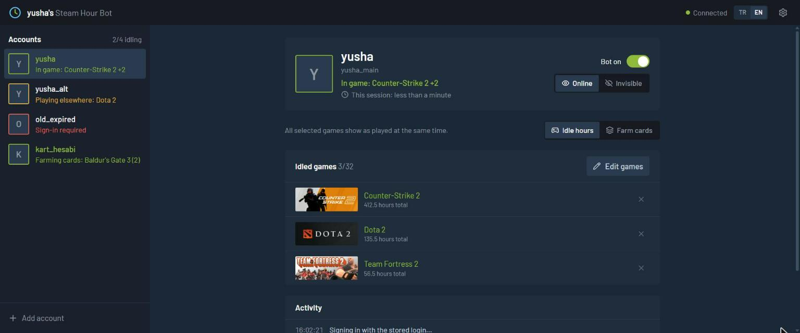
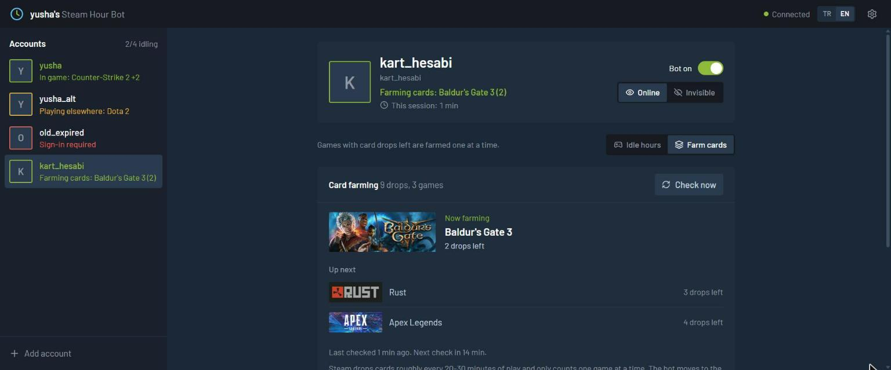
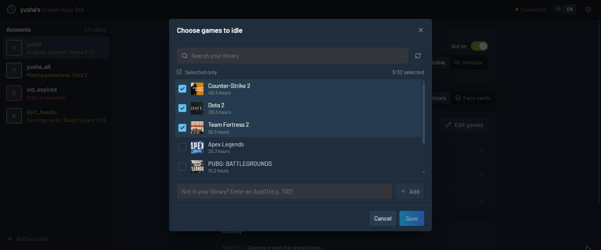
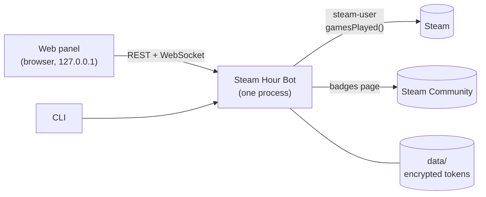

<div align="center">


# yusha's Steam Hour Bot

**Rack up Steam playtime and card drops while your PC sleeps.**<br/>
A headless bot for Windows and Linux with a Steam-styled web panel.

[](https://github.com/yushadev0/steam_hour_bot/releases/latest)




</div>

The bot signs in to your Steam account and tells Steam you're playing the games you pick, so hours tick up and trading cards drop without installing or running a single game. One small binary, no runtime to install, and a panel that looks like it belongs in the Steam client.

## Features

- **Idle up to 32 games at once** per account, the most Steam allows
- **Card farming mode** reads your badges page, idles games with drops left one at a time, and goes back to your game list when everything has dropped
- **Multiple accounts**, each with its own games, mode and visibility
- **Online or invisible**: idle without your friends seeing you in game
- **Steam Guard** by e-mail code, mobile code or approval in the Steam app
- **Your password is never stored**: only Steam's login token, encrypted with AES-256-GCM
- **Plays nice with you**: start a game on your PC and the bot steps aside, then picks up again when you quit
- **Self-healing**: reconnects after network drops and Steam maintenance with backoff
- **Live panel** over WebSocket: status, session timer and an activity log per account
- **Single-file binaries** for Windows and Linux with the panel built in, plus a Docker setup
- **REST + WebSocket API** for your own tools ([docs/API.md](docs/API.md))
- **English and Turkish**: switch the panel and its logs with EN / TR in the top bar

## Quick start

### Windows

1. Download **[steam-hour-bot-windows-x64.exe](https://github.com/yushadev0/steam_hour_bot/releases/latest/download/steam-hour-bot-windows-x64.exe)**
2. Put it in its own folder and double-click it. The panel opens in your browser.
3. Click **Add account**, sign in, pick your games. Done.

> The exe isn't code-signed, so SmartScreen may warn the first time: *More info → Run anyway*. Your accounts live in a `data` folder next to the exe.

### Linux (binary)

```bash
curl -LO https://github.com/yushadev0/steam_hour_bot/releases/latest/download/steam-hour-bot-linux-x64
chmod +x steam-hour-bot-linux-x64
./steam-hour-bot-linux-x64            # panel on http://127.0.0.1:8090
```

To keep it running in the background, use the systemd user service in [deploy/steam-hour-bot.service](deploy/steam-hour-bot.service).

### Linux (Docker)

```bash
git clone https://github.com/yushadev0/steam_hour_bot && cd steam_hour_bot
mkdir -p data
printf 'SHB_UID=%s\nSHB_GID=%s\n' "$(id -u)" "$(id -g)" > .env   # data/ stays owned by you
docker compose up -d --build
```

Update later with `git pull && docker compose up -d --build`.

### Opening the panel on a server

The panel is a local UI: it only listens on `127.0.0.1` and has no password, so nothing is exposed to the internet. From your own computer, tunnel to it:

```bash
ssh -L 8090:127.0.0.1:8090 user@server    # then open http://127.0.0.1:8090
```

## Card farming

Switch an account to **Farm cards** and the bot takes it from there: it checks your badges page every 15 minutes (and right after Steam reports new items), idles the game with the fewest drops left, moves on when it's done, and returns to your normal game list once nothing is left.



## Picking games

Search your library, sorted by playtime. Games you don't own (free weekends, F2P you never launched) can be added by AppID.



## How it works



The bot talks to Steam's servers like a real client would ([steam-user](https://github.com/DoctorMcKay/node-steam-user)). Nothing is installed or launched; Steam simply counts the session as play time. Before showing a game it waits for Steam to say whether the account is already playing somewhere else, so it never knocks you out of a real game.

## CLI

Run the binary (or `npm run cli --`) with a command. Without one, it starts the bot and the panel.

| Command | |
|---|---|
| `add <user>` | Sign in and add an account (asks for the password and Steam Guard once) |
| `login <user>` | Sign in again after the stored login expired |
| `games <user> 730 440` | Set the games to idle (none clears the list) |
| `persona <user> online\|invisible` | Visibility |
| `enable <user>` / `disable <user>` | Turn the bot on or off for an account |
| `remove <user>` | Remove an account and its stored login |
| `list` | Show accounts |
| `smoke` | Test the connection to Steam (anonymous, no account needed) |

Commands that change accounts refuse to run while the server is up; use the panel then.

## Configuration

| Variable | Default | |
|---|---|---|
| `SHB_DATA_DIR` | `./data` | Accounts, encrypted tokens, API tokens |
| `SHB_PORT` | `8090` | Panel and API port |
| `SHB_SECRET` | `data/secret.key` | Token encryption key (generated on first start) |
| `SHB_NO_BROWSER` | | Stop the Windows exe from opening the panel |
| `SHB_LANG` | `tr` | Console log language: `tr` or `en` (the panel has its own switch) |

## Development

Node.js 22+ and [Bun](https://bun.sh) (for the binaries).

```bash
npm install
npm run demo        # server with fake Steam accounts, no real login needed
npm run dev:web     # Vite with hot reload, proxies /api to :8090
npm test            # 55 tests: sessions, card farming, API, WebSocket
npm run build:exe   # single-file binary for this platform, panel embedded
```

Cross-compile the Linux binary with `cd apps/server && bun scripts/build-exe.ts bun-linux-x64`.

| | |
|---|---|
| `apps/server` | Bot, REST/WebSocket API (Fastify), CLI |
| `apps/web` | Panel (React, Vite, Tailwind, TanStack Query) |
| `docs/API.md` | API reference, including the event stream |
| `PLAN.md` | Project plan (Turkish) |

## Disclaimer

Idling games may be against the Steam Subscriber Agreement. This project isn't affiliated with Valve or Steam. Use it at your own risk.
